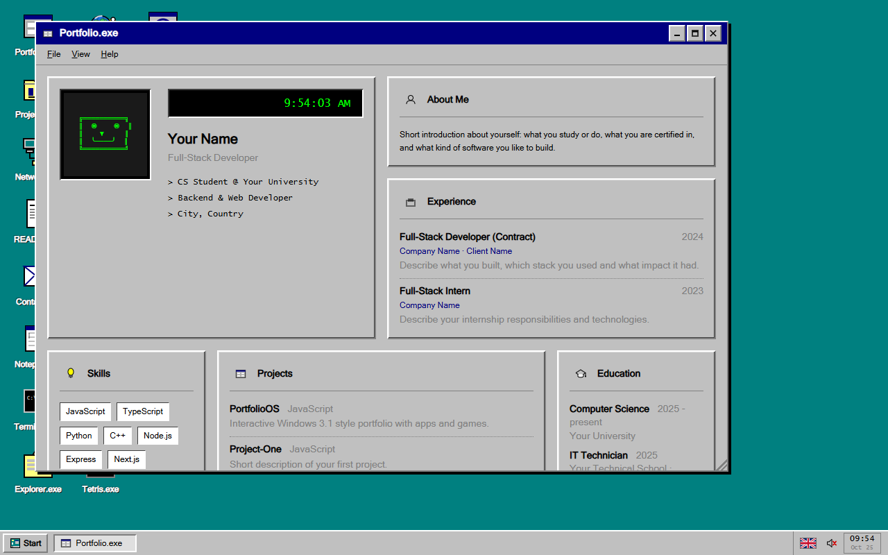
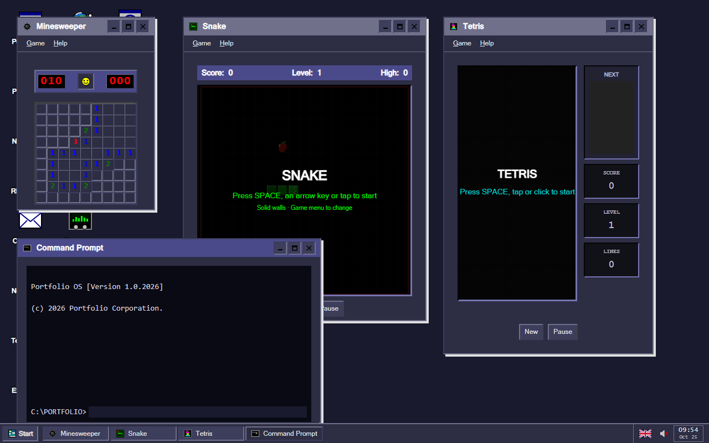
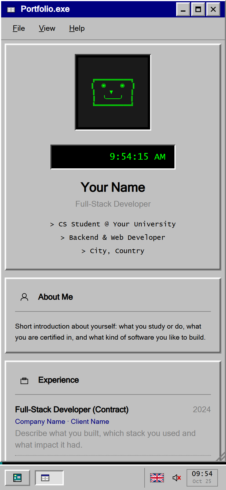

<div align="center">

# Portfolio OS

**A retro desktop that doubles as your developer portfolio.**<br>
Windows 3.1 / 95 look, built with plain HTML, CSS and JavaScript. No frameworks, no bundler.


[Features](#features) &nbsp;·&nbsp; [Quick start](#quick-start) &nbsp;·&nbsp; [Personalization](#personalization) &nbsp;·&nbsp; [Docker deployment](#docker-deployment) &nbsp;·&nbsp; [Adding an app](#adding-an-app)

<br>



</div>

<br>

<table>
  <tr>
    <td width="72%"></td>
    <td width="28%"></td>
  </tr>
  <tr>
    <td align="center"><sub>Games and Terminal in the Dark theme</sub></td>
    <td align="center"><sub>Mobile layout</sub></td>
  </tr>
</table>

## Features

### Desktop

| | |
| --- | --- |
| **Windows** | Draggable, resizable, minimizable, with a taskbar, Start menu and a clock with a calendar popup |
| **Desktop icons** | Snap to a grid; right-click menu with Refresh, Auto Arrange and Sort |
| **Themes** | Teal, Dark, Hot Dog, Matrix, Clouds, Steel, Dither and Aubergine, plus automatic dark mode |
| **Screen savers** | Matrix, Starfield, Flying logos, 3D Pipes and Mystify |
| **BIOS setup** | Press `DEL` during the memory test (or type `bios` in the Terminal) for theme, sound, language, quick boot and screen saver |
| **Languages** | English and Polish, switched with the flag button in the taskbar |
| **Extras** | CRT effect, optional system sounds, session restore (opt-in, kept in local storage) |

### Applications

| App | What it does |
| --- | --- |
| **Portfolio.exe** | The main portfolio in a bento grid |
| **Projects.exe** | Your public GitHub repositories, loaded live and searchable; open a project to read its README |
| **Network.exe** | Live status of the services you self-host, plus server uptime, load and memory |
| **Contact.exe** | Contact form (Node.js API) and social links |
| **Simple View** | The portfolio as a clean document, styled like the printable CV |
| **Internet** | Retro browser: YouTube, Spotify and Vimeo links play in place, Wikipedia search, other sites through the Wayback Machine, and a Time machine for 1996-2015 |
| **Terminal** | Fake DOS prompt with `dir`, `type`, `open`, `neofetch`, `bios`, `matrix` and a few secrets |
| **File Explorer** | Virtual file system with hidden files |
| **Notepad**, **Paint**, **Calculator** | The classics (Notepad saves your text in the browser) |
| **Tunes** | Embedded Spotify player |
| **Control Panel** | Themes, sounds, screen saver and session settings |
| **System Information**, **Task Manager**, **README.txt** | "Hardware" info, running windows and a welcome guide |

### Games

| Game | Highlights |
| --- | --- |
| **Mines** | Three difficulties, safe first click, chording, best times, touch flagging |
| **Snake** | Speed levels, golden bonus apples, solid or wrap-around walls, touch controls |
| **Blocks** | SRS rotation with wall kicks, 7-bag randomizer, ghost piece, soft and hard drop, swipe and hold controls on touch screens |

All three have **top-10 leaderboards** per mode. They are optional and need the backend (see [Leaderboards](#leaderboards)).

### Works without JavaScript

The static portfolio (English and Polish), a printable CV and a contact form that works as a plain HTML form are generated into real pages, so search engines and visitors without JavaScript get the content too. **Download CV** prints on an animated dot-matrix printer first, then opens the printable CV (save it as PDF). Link previews use `og-image.png`.

## Quick start

No build tools needed. Serve the project root with any static server:

```bash
git clone https://github.com/your-github-username/PortfolioOS.git
cd PortfolioOS
python -m http.server 8000
```

Open <http://localhost:8000>. `npx serve` and the VS Code "Live Server" extension work as well.

> Opening `index.html` straight from disk (`file://`) does not work: browsers block ES module imports there.

Contact form and leaderboards need the backend, see [Docker deployment](#docker-deployment). Everything else runs as a plain static site.

## Personalization

All personal data lives in one file, [`js/config.js`](js/config.js).

| Field | Used for |
| --- | --- |
| `name`, `firstName`, `initials`, `title`, `location` | Portfolio header, CV, System Info, File Explorer, footers |
| `bio`, `about` | Hero card and About section |
| `contact.email`, `contact.github`, `contact.discord` | Contact app, Portfolio, CV, Terminal `github` command |
| `experience`, `education`, `skills` | Portfolio, Simple View, CV, `cv.txt` in File Explorer |
| `githubSync` | `true` (default): Projects.exe loads your public repositories live from the GitHub API |
| `projects` | Offline fallback for Projects.exe; entries with `featured: true` also appear in Portfolio, Simple View and CV |
| `links` | Extra targets for the Terminal `open <name>` command |
| `turnstileSiteKey` | Optional Cloudflare Turnstile key (see [Spam protection](#spam-protection)) |

Any text can be a plain string or an `{ en: '...', pl: '...' }` object. UI strings live in [`js/strings.js`](js/strings.js).

After editing `config.js`, regenerate the pages that must work without JavaScript (Node 18+, no dependencies):

```bash
node scripts/build-static.mjs
```

It rewrites the meta tags, structured data and the static portfolio in `index.html`, and creates `pl.html`, `cv.html`, `cv.pl.html`, `404.html`, `robots.txt`, `sitemap.xml` and the `contact-sent` / `contact-error` pages. Use `--config` and `--out` to build from another config into another folder.

Two things are not generated: `og-image.png` (the 1200x630 link preview) and the Spotify track in [`js/apps/TunesApp.js`](js/apps/TunesApp.js).

<details>
<summary><b>Keeping your data out of the repository</b></summary>

<br>

To publish a fork without your personal data, keep placeholders in `config.js` and put the real files in a `private/` folder (ignored by git). A `docker-compose.override.yml` in the repo root (also ignored, loaded automatically by Docker Compose) mounts them over the placeholders:

```yaml
services:
  frontend:
    volumes:
      - ./private/config.js:/usr/share/nginx/html/js/config.js:ro
      - ./private/og-image.png:/usr/share/nginx/html/og-image.png:ro
      - ./private/build/index.html:/usr/share/nginx/html/index.html:ro
      - ./private/build/pl.html:/usr/share/nginx/html/pl.html:ro
      - ./private/build/cv.html:/usr/share/nginx/html/cv.html:ro
      # ...and the other generated pages
```

Generate `private/build` with `node scripts/build-static.mjs --config private/config.js --out private/build`.

</details>

## Docker deployment

Two containers:

- **frontend**: nginx serving the static files and proxying `/api/*` to the backend
- **backend**: Express API for the contact form, the Network app status and the leaderboards

```bash
cp .env.example .env
# fill in your SMTP credentials and CONTACT_EMAIL
docker compose up -d --build
```

The site is then available on port 80 (`FRONTEND_PORT` changes it).

<details>
<summary><b>Environment variables</b></summary>

<br>

| Variable | Description | Default |
| --- | --- | --- |
| `FRONTEND_PORT` | Host port for the website | `80` |
| `SMTP_HOST` | SMTP server | `smtp.gmail.com` |
| `SMTP_PORT` | SMTP port | `587` |
| `SMTP_SECURE` | TLS from the start (`true` for port 465) | `false` |
| `SMTP_USER` | SMTP login, also used as the sender address | none |
| `SMTP_PASS` | SMTP password; for Gmail use an [App Password](https://support.google.com/accounts/answer/185833) | none |
| `CONTACT_EMAIL` | Where contact form messages are delivered | `SMTP_USER` |
| `STATUS_SERVICES` | Services shown in Network.exe as `Name\|https://url` pairs separated by commas; without it the app reports that status is unavailable | none |
| `STATUS_HOST_LABEL` | Name shown for the server running the backend | hostname |
| `GITHUB_USER`, `GITHUB_TOKEN` | GitHub login and a read-only token; Projects.exe then marks the repositories pinned on your profile as featured (cached 15 min). Without them the `featured` flags in `js/config.js` apply | none |
| `TURNSTILE_SECRET` | Cloudflare Turnstile secret; when set, the contact form and leaderboard submissions require the check | none |
| `CORS_ORIGIN` | Allowed origin for the API | `*` |
| `SCORES_FILE` | Where the leaderboards are stored | `/data/scores.json` in Docker |

The backend uses Helmet security headers, input validation, HTML escaping, a honeypot field and rate limiting (5 contact messages per 15 minutes per IP, read from `CF-Connecting-IP` behind Cloudflare).

</details>

### Leaderboards

When a game ends with a top-10 result, the player is asked for a nickname. The backend keeps one board per mode (Snake solid / wrap, Mines beginner / intermediate / expert, Blocks) in a single JSON file on the `portfolio-data` Docker volume, so it survives rebuilds.

- Only the nickname, score and date are stored. IP addresses are used in memory for rate limiting (20 submissions per 15 minutes) and never written down.
- Nicknames go through a profanity filter and scores through sanity limits. With Turnstile enabled, every submission needs the check too.
- The games run in the visitor's browser, so a score cannot be proven genuine. Treat the boards as a friendly toplist, not a competition.
- To remove an entry, edit `scores.json` and restart the backend.

### Spam protection

Cloudflare Turnstile is optional.

1. In the Cloudflare dashboard open **Turnstile**, add your domain and create a widget.
2. Put the **site key** (public) in `js/config.js` as `turnstileSiteKey` and the **secret key** in `.env` as `TURNSTILE_SECRET`.
3. Rebuild the static pages (`node scripts/build-static.mjs`) and restart the containers.

The widget loads when the Contact window opens (and when a leaderboard nickname is requested); Send stays disabled until it passes. Turnstile needs JavaScript, so with a site key set the no-JS page shows your e-mail address instead of the form. Without a key, the honeypot and rate limit are the only protection.

### Running the backend without Docker

```bash
cd backend
npm install
SMTP_USER=you@example.com SMTP_PASS=your-app-password npm start
```

The frontend calls `/api/...`, so put a reverse proxy in front of it (see [`nginx.conf`](nginx.conf)).

## Project structure

```
PortfolioOS/
├── index.html            App shell, boot screen, desktop markup
├── cv.html, pl.html ...  Generated no-JS pages
├── scripts/
│   └── build-static.mjs  Builds the no-JS pages from js/config.js
├── css/                  main.css imports variables, base, desktop, window, components, apps, boot
├── js/
│   ├── config.js         Your personal data (edit this!)
│   ├── strings.js        English / Polish UI strings
│   ├── main.js           Boot sequence and desktop logic
│   ├── leaderboard.js    Nickname prompt and leaderboard dialogs
│   ├── icons.js          SVG icon set
│   ├── apps/             One module per application
│   ├── components/       Window and desktop icon components
│   └── managers/         Windows, dialogs, sounds, storage, screen savers, desktop grid
├── backend/              Contact form, status and leaderboard API (Express)
├── Dockerfile            Frontend image (nginx)
├── docker-compose.yml
├── nginx.conf
└── .env.example
```

### Adding an app

1. Create `js/apps/MyApp.js` exporting an object with `id`, `title`, `icon`, `render()` and optionally `onInit()`, `onClose()`, `menuConfig` and `onMenuAction()`. `CalcApp.js` is a good small reference.
2. Register it in [`js/apps/index.js`](js/apps/index.js).
3. Add styles to `css/apps.css`.

> Imports carry a `?v=15` query string for cache busting. Bump it across files when you deploy changes behind aggressive caches.

## Browser support

Current Chrome, Firefox, Safari and Edge (ES modules and CSS custom properties are required).

## License

Released under the [MIT License](LICENSE). Fork it and build your own portfolio on top.
